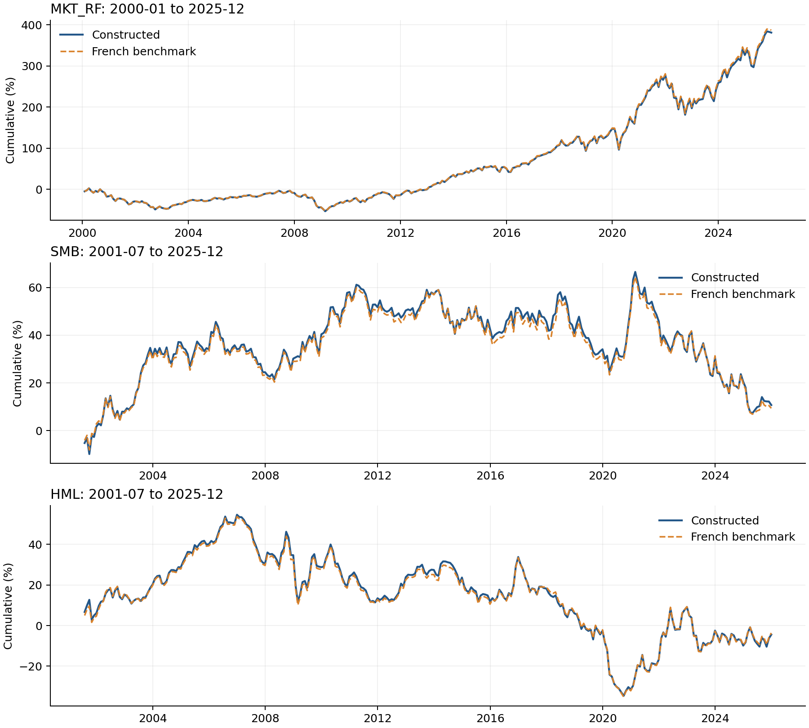

# Empirical Replication References

This document combines three replication references in their original order. File links point to their corresponding folders in this repository. Methodological qualifications, results, and source links are retained.

> **Repository layout:** [Fama3](Fama3/README.md) · [index effect](index%20effect/README.md) · [Momentum](Momentum/README.md)

## Fama–French Three-Factor Reference, 2000–2025

### Possible errors and coverage limits

Differences from the official benchmark may reflect security eligibility timing, Compustat history screening, share-class and CCM link handling, missing-return treatment, data revisions, and rounding. Their individual contributions have not been established. This implementation does not impose a strict two-year Compustat history requirement.

**MKT−RF covers January 2000–December 2025 (312 months). SMB and HML cover July 2001–December 2025 (294 months).** Their first 18 months are blank because formation-period data are missing. Blank values are not zero returns.

### Files

| File | Contents and units |
|---|---|
| [monthly_factors.csv](Fama3/monthly_factors.csv) | Monthly constructed factors, official factors, and RF. Decimal returns: **0.01 = 1%**. |
| [summary_statistics.csv](Fama3/summary_statistics.csv) | Monthly mean, sample standard deviation, minimum, and maximum, in **percent**. |
| [benchmark_comparison.csv](Fama3/benchmark_comparison.csv) | Comparison periods, correlations, mean errors, and RMSE. Errors are in **percentage points**. |
| [cumulative_returns.png](Fama3/cumulative_returns.png) | Cumulative returns for each factor, compared with the official benchmark. |

`constructed` denotes this replication; `benchmark` denotes the Kenneth French series. The official file uses the **2026-07 CRSP database release**. Comparisons use the same available months for each pair of series.

### Main results

MKT−RF is the market excess return, SMB is small minus big, and HML is high minus low book-to-market. SMB and HML are constructed from six size/B/M portfolios; the market factor is calculated separately.

| Factor | Months | Correlation | Mean error (pp/month) | RMSE (pp/month) |
|---|---:|---:|---:|---:|
| MKT−RF | 312 | 0.99998 | −0.00372 | 0.02644 |
| SMB | 294 | 0.99671 | +0.00490 | 0.21387 |
| HML | 294 | 0.99603 | −0.00194 | 0.27810 |

Error means constructed minus benchmark. Lower RMSE indicates closer monthly agreement. All three factors track the benchmark closely, but the results are not identical. Full descriptive statistics are in `summary_statistics.csv`.

### Cumulative returns

Each panel compounds monthly decimal returns as:

$$C_T=\prod_{t=1}^{T}(1+r_t)-1.$$

The chart displays this value in percent. Blue is constructed; dashed orange is the benchmark. Each pair starts at its first common available month.

These are factor-return illustrations, not fund NAVs. They are assignment diagnostics, not a reproduction of a specific figure in the 1993 paper. The implementation follows modern benchmark conventions, including the updated book-equity definition.

Source: [Kenneth French Data Library](https://mba.tuck.dartmouth.edu/pages/faculty/ken.french/data_library.html).

---

## Index Effect Reference, 2000–2020

### Possible errors and coverage limits

This is a modern-sample adaptation of Shleifer (1986), Tables I–II, not a reproduction of the original historical estimates. Differences may arise from announcement timing, estimation windows, missing returns, data revisions, and sample exclusions. Announcements are assumed to occur after market close. The 2000–2009 / 2010–2020 split is descriptive, not the original regime split.

The market model uses estimation windows [-250, -21] and [+61, +250], with at least 120 valid trading days per side. These are implementation choices. Reported t-statistics now use the Ruback first-order serial-correlation adjustment cited by Shleifer. The variance-estimation endpoints and finite-sample denominators remain explicit implementation choices because Shleifer does not fully specify them. Original news-based exclusions are not replicated.

### Replication scope

The assignment targets **Shleifer’s Tables I and II**, both of which concern additions. The supplied Greenwood–Sammon directory contains additions and deletions for 2000–2020; deletions are not required in these two tables. Greenwood–Sammon supplies the modern events, not the table definitions or precomputed returns.

The event windows and market-model cumulative prediction errors match the requested analyses. **The Ruback variance formula is now used; historical sample partitions and incompletely documented calibration details remain adaptation choices.** **The 2000–2009 / 2010–2020 split was chosen by this replication for descriptive comparison; it is not specified by Shleifer and does not represent a verified notification-regime change in 2010.**

- **Original Table I:** 1966–1975 versus September 1976–1983, separating the periods before and after S&P introduced its early-warning notification service. The change affected how promptly index changes were communicated and how precisely announcement dates could be identified.
- **Original Table II:** the full September 1976–1983 sample, with early September 1976–1980 and later 1981–1983 subsamples, examining persistence within the post-service period.

This replication instead uses 2000–2009 and 2010–2020 in both tables, with the full 2000–2020 sample also shown in Table II. It therefore does not reproduce the original distinction between regime comparison (Table I) and subperiod comparison within the later regime (Table II). These results are therefore a modern-sample reference with disclosed methodological changes, not an exact original-method answer key.

### Files

| File | Contents and units |
|---|---|
| [table1.csv](index%20effect/table1.csv) | Abnormal returns before, on, and after the announcement reaction day; early and later samples. |
| [table2.csv](index%20effect/table2.csv) | Cumulative abnormal returns from the reaction day through 5, 10, 20, and 60 trading days; full and subsample results. |

Return cells show **percent (Ruback-adjusted t-statistic)**. `N events` counts additions. No clustered standard errors are used. These are the complete result tables for student comparison.

### Sample and calculation

The sample contains **427 S&P 500 additions**: 230 in 2000–2009 and 197 in 2010–2020. Of 515 unique candidate events, 86 lack sufficient pre-event estimation data and 2 lack sufficient post-event estimation data. All table rows use the same complete events within each sample.

Greenwood–Sammon’s event directory supplies identifiers and announcement dates. Stock returns and the CRSP value-weighted market return are read from the supplied Parquet file. Abnormal returns are calculated independently as market-model residuals, summed over trading days, then averaged equally across events. Pre-event estimates apply through AD; post-event estimates apply after AD.

**AD** is the first trading day strictly after the recorded announcement date. Window endpoints are included: AD through AD+60 contains 61 daily returns.

The reported statistic is

$$t=\frac{CAPE[a,b]}{\sqrt{Q\hat\gamma_0+2(Q-1)\hat\gamma_1}},\qquad Q=b-a+1.$$

Here $\hat\gamma_0$ is the time-series variance of average prediction errors (APE), and $\hat\gamma_1$ is their lag-one covariance, estimated outside [-20, +60] using the existing pre/post estimation intervals. Only relative days observed for every event in the relevant sample enter APE; adjacent pairs never bridge missing days or the event window. There is no additional division by the number of events. The full and early samples use 268 calibration days (266 adjacent pairs); the later sample uses 420 (418). Sample variance and pairwise covariance use denominators M−1 and P−1, respectively. These calibration details are disclosed rather than attributed to the authors’ original code.

### Table I — Abnormal Returns Around Inclusion

| Event window | Early 2000–2009 | Later 2010–2020 |
|---|---:|---:|
| AD−20 through AD−1 | -0.786% (-0.94) | 0.004% (0.01) |
| AD | 2.947% (16.78) | 0.959% (7.42) |
| AD+1 through AD+10 | -0.114% (-0.19) | -0.694% (-1.73) |
| AD+11 through AD+20 | -0.968% (-1.64) | 0.221% (0.55) |
| N events | 230 | 197 |

### Table II — Persistence of Abnormal Returns

| Event window | Full 2000–2020 | Early 2000–2009 | Later 2010–2020 |
|---|---:|---:|---:|
| AD | 2.030% (18.00) | 2.947% (16.78) | 0.959% (7.42) |
| AD through AD+5 | 1.866% (6.68) | 2.956% (6.50) | 0.593% (1.91) |
| AD through AD+10 | 1.648% (4.35) | 2.833% (4.58) | 0.265% (0.63) |
| AD through AD+20 | 1.229% (2.35) | 1.865% (2.18) | 0.486% (0.84) |
| AD through AD+60 | 0.556% (0.62) | 0.652% (0.45) | 0.445% (0.45) |
| N events | 427 | 230 | 197 |

The announcement effect is positive and smaller in the later sample. The full-sample 60-day estimate has a t-statistic of 0.62, giving little evidence against zero; this does not establish complete reversal. The tables do not formally test the difference between periods.

Sources: [Shleifer (1986)](https://doi.org/10.1111/j.1540-6261.1986.tb04518.x); [Greenwood and Sammon (2025)](https://doi.org/10.1111/jofi.13410).

Variance formula cross-check: [Cleveland Fed Economic Review, 1985 Q3, event-study appendix A1–A2](https://fraser.stlouisfed.org/files/docs/publications/frbclevreview/rev_frbclev_1985q3.pdf), explicitly following Ruback (1982).

---

## Momentum: Jegadeesh and Titman (1993)

### Possible differences from the original paper

The original Tables I–III use 1965–1989 data; this replication evaluates 2002–2025 using modern CRSP data. Differences may also come from CRSP data revisions, delisting returns, the seven-calendar-day interpretation of a one-week skip, and the stated rules for missing returns and beta estimation. The goal is to reproduce the paper's analyses with current data, not its historical estimates.

The daily data begin in 2000. The longest 12/12 strategy needs prior returns and overlapping holding portfolios, so 2000–2001 is used for formation and the common evaluation period starts in 2002.

### Files

| File | Contents |
| --- | --- |
| `Jegadeesh_Titman_1993_replication.ipynb` (not shown in the current repository) | Code for Tables I–III; reads the three supplied files in `data/` |
| [output/table1.csv](Momentum/table1.csv) | 32 J/K strategies, with and without a one-week skip |
| [output/table2.csv](Momentum/table2.csv) | Beta and average market capitalization of the 6/6 deciles |
| [output/table3a.csv](Momentum/table3a.csv) | 6/6 returns within size and prior-year-beta groups |
| [output/table3b.csv](Momentum/table3b.csv) | Market-model abnormal returns for those groups |

### Main results

**Table I: Winner minus loser monthly return** (percent). Panel A forms immediately; Panel B skips one week.

| J (months) | A: K=3 | A: K=6 | A: K=9 | A: K=12 | B: K=3 | B: K=6 | B: K=9 | B: K=12 |
| ---: | ---: | ---: | ---: | ---: | ---: | ---: | ---: | ---: |
| 3 | 0.42% | 0.51% | 0.54% | 0.47% | 0.57% | 0.62% | 0.60% | 0.53% |
| 6 | 0.74% | 0.90% | 0.79% | 0.61% | 0.90% | 0.97% | 0.93% | 0.74% |
| 9 | 0.88% | 0.93% | 0.77% | 0.59% | 1.14% | 0.94% | 0.78% | 0.59% |
| 12 | 0.81% | 0.69% | 0.64% | 0.49% | 0.93% | 0.74% | 0.62% | 0.47% |

All 32 spreads are positive. For the immediate 6/6 strategy, the mean is **0.90%** (t = 2.34); with a one-week skip it is **0.97%** (t = 2.59).

**Table II: Immediate 6/6 portfolio characteristics.** Market capitalization is in USD millions.

| Portfolio | Market beta | Average market capitalization |
| --- | ---: | ---: |
| P1 | 1.725 | 1,781 |
| P10 | 1.205 | 5,551 |
| P10-P1 | -0.520 | — |

**Table III: Immediate 6/6 winner minus loser results.** Values are monthly percent; t-statistics are in parentheses. S1–S3 sort from small to large firms; B1–B3 sort from low to high prior-year beta.

| Group | Panel A: raw return | Panel B: market-model alpha |
| --- | ---: | ---: |
| All | 0.90% (2.34) | 1.26% (3.44) |
| S1 | 1.50% (3.09) | 1.90% (4.00) |
| S2 | 0.70% (1.70) | 1.13% (2.94) |
| S3 | 0.37% (1.14) | 0.67% (2.13) |
| B1 | 0.58% (1.77) | 0.82% (2.54) |
| B2 | 0.47% (1.31) | 0.83% (2.46) |
| B3 | 1.89% (3.86) | 2.18% (4.59) |

For the full sample, the joint equal-mean test in Panel A has p = 0.2050; the joint-alpha test in Panel B has p = 0.0082. The CSV files contain every decile and test statistic.

If the replication notebook is added to the repository, open it and run its cells in order. `cache/` holds intermediate calculations and can be rebuilt from `data/`; it is not a result. Returns in the CSV files are shown as percentages, with t-statistics in parentheses where applicable. Source: [Jegadeesh and Titman (1993)](https://doi.org/10.1111/j.1540-6261.1993.tb04702.x).
